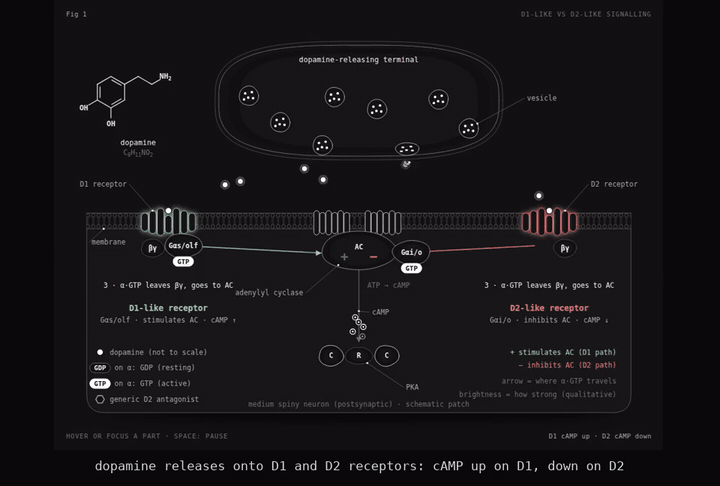
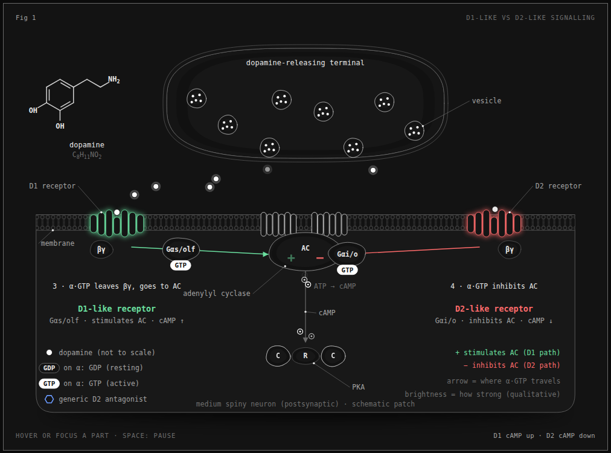
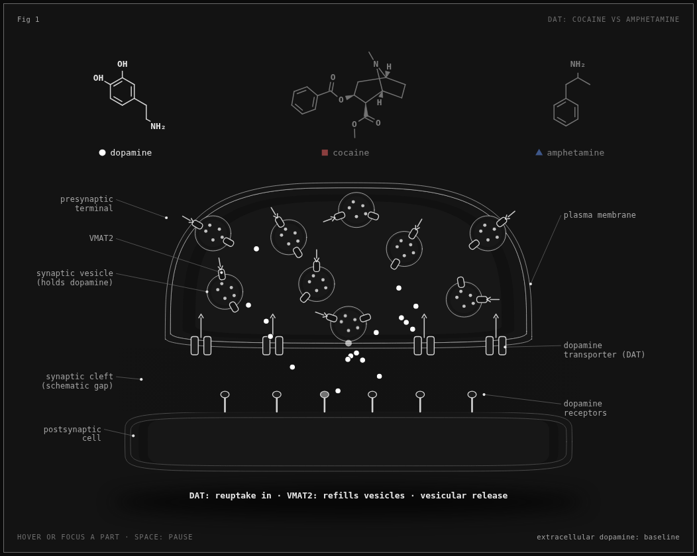
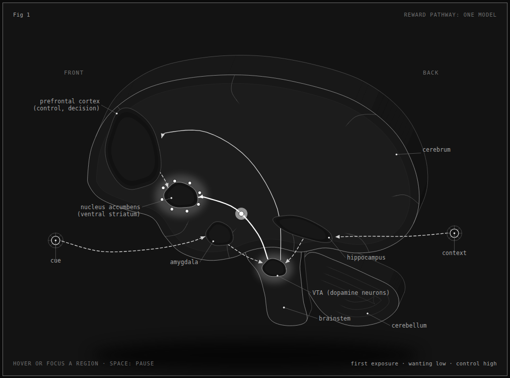
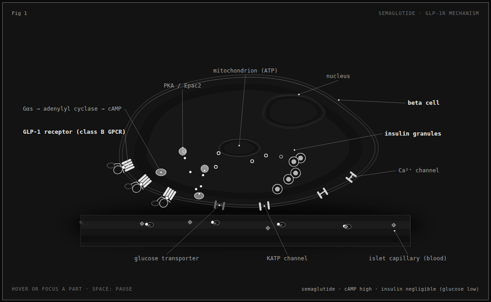
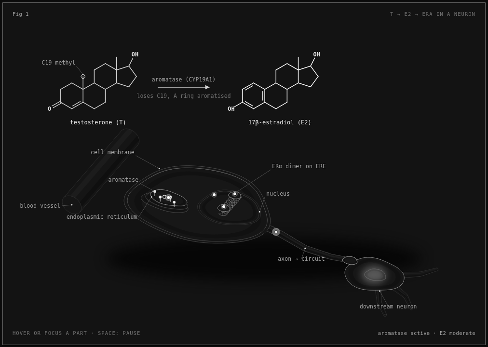
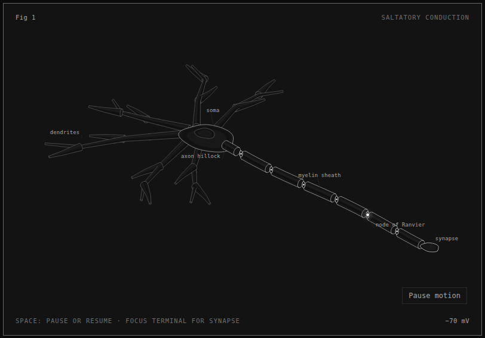
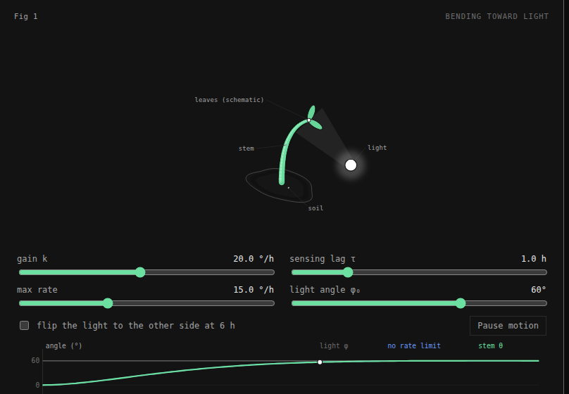

# Anima

**Ask Claude for a biology figure. Get an interactive, sourced, isometric one.**

<p>
  <a href="LICENSE"></a>
  <a href="https://github.com/Garinmckayl/anima/actions/workflows/ci.yml"></a>
  <a href="https://github.com/Garinmckayl/anima/releases"></a>
  <a href="https://github.com/Garinmckayl/anima/stargazers"></a>
  
</p>

A [Claude Code](https://claude.com/claude-code) skill that turns "show me how cocaine and amphetamine act differently at a dopamine synapse" into a live, standalone page: real structures, a mechanism you can toggle, a readout driven by one small model, and a citation for every number on screen.

<p align="center">
  
</p>

<p align="center">
  <a href="https://anima.arcumet.com"><b>Try every figure live (no install)</b></a> ·
  <a href="assets/anima-launch.mp4">35-second launch video</a> ·
  <a href="assets/demo.mp4">Full demo (MP4)</a> ·
  <a href="https://github.com/Garinmckayl/anima/issues/new?template=figure_request.yml">Request a figure</a>
</p>

## Why it exists

Most science graphics are either static diagrams or confident-looking animations with no sources. This skill holds itself to a different standard:

- **Show the real structure.** Receptors, transporters, vesicles, brain regions and skeletal formulas, drawn as what they are. A mechanical metaphor is allowed only when it is labelled as one.
- **Every number is cited.** If a figure shows a half-life, a homology or a trial size, the source is on the page, with its conditions. Numbers that could not be verified are left out, not rounded into plausibility.
- **Say how sure we are.** Each figure separates what is established from what is one leading model, and what is rodent work from what is human work. The estrogen figure states outright that the human evidence is weak.
- **Make it move for a reason.** Toggles change the mechanism, not the decoration: block a receptor, block a transporter, change glucose, change exposure.
- **Educational, never advice.** Drug figures explain mechanism only: no doses, no routes, no schedules, no recommendations.

## Install

```sh
npx skills add Garinmckayl/anima -g -a claude-code
```

Requires Claude Code and Node.js 20.10 or later. The drawing kit uses only Node built-ins and has zero runtime dependencies. Chrome or Chromium is needed only for the capture and verification scripts.

## Use it

In Claude Code:

```text
/anima show how cocaine and amphetamine act differently at the dopamine transporter, with a drug selector and sourced mechanisms; standalone HTML
```

```text
/anima visualize semaglutide acting on a pancreatic beta cell, with glucose-dependent insulin release, cited label numbers and an educational-use note
```

```text
/anima show D1 and D2 receptor signalling in a striatal neuron, with the G-protein cycle and a receptor-antagonist toggle
```

```text
/anima make a mid-sagittal brain showing the mesolimbic pathway and one model of how it changes with repeated drug exposure; cite every claim
```

More to try:

```text
/anima show how CRISPR-Cas9 finds and cuts a target sequence, with a guide-mismatch toggle and cited cleavage numbers
```

```text
/anima animate the mitochondrial electron transport chain with a proton-gradient readout and an inhibitor toggle
```

Name the biological subject, the mechanism to explain, the audience and the output format. The skill sizes the job first (Figure, Hero or Epic), collects sources before drawing, builds the page, then checks it the way a reviewer would: zoomed in, in both themes, at phone width.

## Gallery

Each figure builds to a standalone HTML page in dark and light themes. The links open the live pages, so they run in your browser. To open them from a clone, use the files in `examples/`.

| | |
|---|---|
| **[Dopamine receptors](https://anima.arcumet.com/examples/dopamine-receptors/dopamine-receptors.html)** ([light](https://anima.arcumet.com/examples/dopamine-receptors/dopamine-receptors-light.html))<br>D1-like receptors couple Gαs/olf and raise cAMP; D2-like receptors couple Gαi/o and lower it. Full G-protein cycle, a dopamine-level slider and a generic D2-antagonist toggle.<br><a href="https://anima.arcumet.com/examples/dopamine-receptors/dopamine-receptors.html"></a> | **[Stimulants at the transporter](https://anima.arcumet.com/examples/stimulants-dat/stimulants-dat.html)** ([light](https://anima.arcumet.com/examples/stimulants-dat/stimulants-dat-light.html))<br>None, cocaine or amphetamine. Reuptake, blockade, and amphetamine's transport, vesicle leak and reverse efflux. Skeletal formulas from PubChem.<br><a href="https://anima.arcumet.com/examples/stimulants-dat/stimulants-dat.html"></a> |
| **[Reward and addiction](https://anima.arcumet.com/examples/reward-addiction/reward-addiction.html)** ([light](https://anima.arcumet.com/examples/reward-addiction/reward-addiction-light.html))<br>The mesolimbic pathway, a cue sequence, and one leading model of what changes after repeated exposure. Framed as a model, with sources.<br><a href="https://anima.arcumet.com/examples/reward-addiction/reward-addiction.html"></a> | **[Semaglutide and GLP-1](https://anima.arcumet.com/examples/semaglutide-glp1/semaglutide-glp1.html)** ([light](https://anima.arcumet.com/examples/semaglutide-glp1/semaglutide-glp1-light.html))<br>A GLP-1 receptor agonist on a beta cell: glucose-dependent insulin release, the molecule's engineered features, and the preclinical-versus-clinical state of the appetite and reward evidence.<br> |
| **[Estrogen and aggression](https://anima.arcumet.com/examples/estrogen-aggression/estrogen-aggression.html)** ([light](https://anima.arcumet.com/examples/estrogen-aggression/estrogen-aggression-light.html))<br>Testosterone to estradiol by aromatase, then estrogen receptor α, in an amygdala-type neuron. States that the human evidence is weak (pooled Fisher z 0.16 across 14 studies).<br><a href="https://anima.arcumet.com/examples/estrogen-aggression/estrogen-aggression.html"></a> | **[A myelinated neuron](https://anima.arcumet.com/examples/neuron/neuron.html)** ([light](https://anima.arcumet.com/examples/neuron/neuron-light.html))<br>Saltatory conduction along a myelinated axon with a hoverable synapse.<br><a href="https://anima.arcumet.com/examples/neuron/neuron.html"></a> |
| **[Sunflower seedling bending toward light](https://anima.arcumet.com/examples/sunflower-bend/sunflower-bend.html)** ([light](https://anima.arcumet.com/examples/sunflower-bend/sunflower-bend-light.html))<br>BendLab's two-state model (sensing lag and a saturating bend rate) running live. Move the sliders to see when the rate limit matters and when it can't be read from the trajectory. Model by [BendLab](https://github.com/Yash-Tripath1/Bendlab), reviewed for accuracy by its author; not peer reviewed. Includes three fitted presets from the author.<br><a href="https://anima.arcumet.com/examples/sunflower-bend/sunflower-bend.html"></a> | |

## What every figure has

- A framed card: `Fig n` top left, a short title top right, the interaction hint bottom left, a live readout bottom right.
- One small pure model that drives both the motion and the readout.
- Hover or keyboard focus on any part for a one-line explanation.
- A pause control (Space), a still frame under `prefers-reduced-motion`, and no animation while offscreen.
- A sources block with real links, a plain list of what was simplified, and an educational-not-medical-advice note.
- Both themes, with light as a first-class citizen.

## Make your own

Copy the closest example and change the biology:

```sh
node examples/dopamine-receptors/build.mjs
node examples/dopamine-receptors/build.mjs --light
```

Each `build.mjs` imports the kit from `kit/` and writes standalone pages next to itself. `kit/blob.mjs` draws organic forms, `kit/branch.mjs` branching structures, `kit/chem.mjs` molecules, helices and ribbons, and `kit/bio-audit.mjs` checks membrane intersections, label targets and declared scale. WebGL shaders and a 3D mode are optional extras for figures that need them.

Record a demo of your own figures with `scripts/make-demo.mjs` (needs Chrome and ffmpeg), and check a page with `scripts/capture.mjs`, `scripts/drive.mjs` and `scripts/lines.mjs`. [`CONTRIBUTING.md`](CONTRIBUTING.md) lists every check.

## How it works

- [`SKILL.md`](SKILL.md) defines the workflow, visual standards, sourcing rules and safety limits.
- [`kit/`](kit) is the isometric drawing library plus the biology primitives.
- [`references/`](references) has general, neurobiology, pharmacology and molecular-biology guidance alongside the craft and rendering guides.
- [`evals/evals.json`](evals/evals.json) holds representative biology requests with what a good answer must contain.

## Sources and limits

Every displayed number, including sizes, concentrations, potentials, rates and doses, must cite its source in the caption or a sources block, with species, tissue, conditions and units. Schematic scales are labelled as schematic.

These are educational figures. They are not medical advice, not a validated anatomy atlas, and not a diagnostic or prescribing tool. Drug figures explain mechanism only. Biology varies between species, tissues and individuals, and a 2D or isometric illustration cannot capture every spatial relationship.

If you or someone you know is struggling with substance use, a local health service or helpline can help.

## Contribute

Anima grows by figures. If a subject you know well is missing, [request it](https://github.com/Garinmckayl/anima/issues/new?template=figure_request.yml) or send a pull request with one. Issues labelled [good first issue](https://github.com/Garinmckayl/anima/labels/good%20first%20issue) are a place to start, and [`CONTRIBUTING.md`](CONTRIBUTING.md) lists every check.

If Anima saved you time, a [star](https://github.com/Garinmckayl/anima) helps others find it.

## License

MIT. See [LICENSE](LICENSE).
